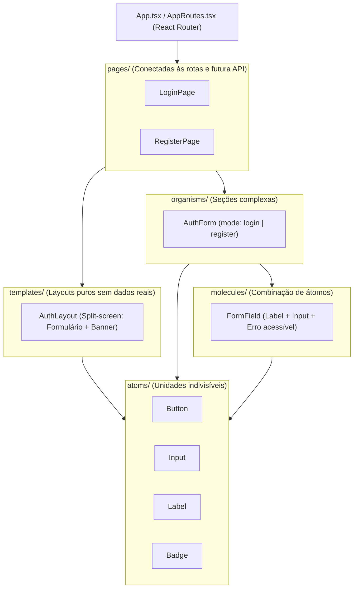

# Plano de Implementação — Telas de Login e Cadastro (`apps/web`)

## 1. Contexto e Diagnóstico Atual

Após inspeção do monorepo, este é o estado atual de `apps/web`:

- **Base existente:** Template inicial em React 19 (`^19.3.1`) + TypeScript (`~6.0.3`) + Vite (`^8.3.6`), ainda com os estilos padrão de demonstração (`src/index.css` com `#root { width: 1126px }` e `src/App.css`).
- **Assets já disponíveis em `apps/web/public/`:**
  - `/banner-login.jpg` — Navio navegando na névoa noturna da Grand Line rumo a uma ilha misteriosa, com um Log Pose brilhando em ciano no guarda-corpo.
  - `/banner-register.jpg` — Taverna costeira iluminada por lanternas no cais à noite, com mural de mapas/contratos e tripulações reunidas.
  - `/logo-grand-line.jpg` — Emblema com timão dourado e bússola Log Pose ciano sobre fundo azul abissal.
- **Lacunas identificadas no `apps/web/package.json`:**
  1. **Tailwind CSS v4** (`tailwindcss` + `@tailwindcss/vite`) ainda não está instalado nem registrado no `vite.config.ts`.
  2. **React Router** (`react-router-dom`) ainda não está instalado.
  3. **Suíte de Testes e Acessibilidade** (`vitest`, `jsdom`, `@testing-library/react`, `@testing-library/user-event`, `@testing-library/jest-dom`, `jest-axe`, `@types/jest-axe`) e o script `"test"` ainda não estão configurados em `apps/web`, embora sejam exigidos pelo `AGENTS.md` (`pnpm web:test`).

---

## 2. Arquitetura e Hierarquia Atomic Design

Seguindo rigorosamente o `AGENTS.md`, nenhum nível importará de um nível superior:



### Estrutura de Diretórios Planejada (`apps/web/src/`)

```text
apps/web/src/
├── components/
│   ├── atoms/
│   │   ├── Badge/
│   │   │   ├── Badge.tsx
│   │   │   ├── Badge.test.tsx
│   │   │   └── index.ts
│   │   ├── Button/
│   │   │   ├── Button.tsx
│   │   │   ├── Button.test.tsx
│   │   │   └── index.ts
│   │   ├── Input/
│   │   │   ├── Input.tsx
│   │   │   ├── Input.test.tsx
│   │   │   └── index.ts
│   │   └── Label/
│   │       ├── Label.tsx
│   │       ├── Label.test.tsx
│   │       └── index.ts
│   ├── molecules/
│   │   └── FormField/
│   │       ├── FormField.tsx
│   │       ├── FormField.test.tsx
│   │       └── index.ts
│   ├── organisms/
│   │   └── AuthForm/
│   │       ├── AuthForm.tsx
│   │       ├── AuthForm.test.tsx
│   │       └── index.ts
│   ├── templates/
│   │   └── AuthLayout/
│   │       ├── AuthLayout.tsx
│   │       ├── AuthLayout.test.tsx
│   │       └── index.ts
│   └── pages/
│       ├── LoginPage/
│       │   ├── LoginPage.tsx
│       │   ├── LoginPage.test.tsx
│       │   └── index.ts
│       └── RegisterPage/
│           ├── RegisterPage.tsx
│           ├── RegisterPage.test.tsx
│           └── index.ts
├── routes/
│   └── AppRoutes.tsx
├── test/
│   └── setup.ts
├── App.tsx
├── App.test.tsx
├── index.css
└── main.tsx
```

*(Os arquivos legados do template inicial `src/App.css`, `src/assets/hero.png`, `src/assets/react.svg` e `src/assets/vite.svg` serão removidos para manter o repositório limpo.)*

---

## 3. Etapas Detalhadas de Execução

### Etapa 1 — Instalação de Dependências e Configuração de Build/Testes

1. **Instalar pacotes de produção em `apps/web`:**
   - `pnpm --filter web add react-router-dom`
2. **Instalar pacotes de desenvolvimento em `apps/web`:**
   - `pnpm --filter web add -D tailwindcss @tailwindcss/vite vitest jsdom @testing-library/react @testing-library/dom @testing-library/user-event @testing-library/jest-dom jest-axe @types/jest-axe`
   - *(Observação: caso `@tailwindcss/vite` apresente restrição de peer dependency com `vite@^8.3.6`, utilizaremos `@tailwindcss/postcss` + `postcss` ou configuração equivalente nativa do Tailwind v4 sem alterar a sintaxe `@import "tailwindcss"` e `@theme`.)*
3. **Atualizar `apps/web/vite.config.ts`:**
   - Registrar o plugin `tailwindcss()` junto ao `react()`.
   - Configurar o bloco `test` do Vitest (`environment: 'jsdom'`, `globals: true`, `setupFiles: './src/test/setup.ts'`).
4. **Atualizar `apps/web/package.json` e `tsconfig.app.json`:**
   - Adicionar `"test": "vitest run"` e `"test:watch": "vitest"` em `scripts` (habilitando `pnpm web:test` na raiz).
   - Configurar `src/test/setup.ts` registrando os matchers de `@testing-library/jest-dom/vitest` e `toHaveNoViolations` do `jest-axe`.

---

### Etapa 2 — Fontes, Reset e `@theme` do Tailwind v4 (`index.html` e `src/index.css`)

#### 2.1. `apps/web/index.html`
- Alterar idioma para `<html lang="pt-BR">`.
- Atualizar favicon para `/logo-grand-line.jpg` e `<title>Grand Line Hub</title>`.
- Carregar fontes do Google Fonts com `preconnect`:
  - **Cinzel** (`600`, `700`) — Títulos épicos, cabeçalhos náuticos e estética de cartazes/crônicas de One Piece (`--font-display`).
  - **Plus Jakarta Sans** (`400`, `500`, `600`, `700`) — Leitura fluida de interface, labels, inputs e textos longos com suporte completo a acentuação em português (`--font-sans`).
  - **JetBrains Mono** (`400`, `600`) — Valores de recompensas em Berries, coordenadas e carimbos (`--font-mono`).

#### 2.2. Paleta Semântica e Contraste WCAG 2 AA (`apps/web/src/index.css`)

Os valores escolhidos foram extraídos diretamente da direção de arte de `/logo-grand-line.jpg`, `/banner-login.jpg` e `/banner-register.jpg`, e calibrados para aprovação em contraste **WCAG 2 AA (>= 4.5:1 para texto normal)**:

| Token Tailwind (`@theme`) | Variável CSS | Hex | Papel Semântico (`AGENTS.md`) | Contraste validado |
| :--- | :--- | :--- | :--- | :--- |
| `ocean-abyss` | `--color-ocean-abyss` | `#07131F` | Fundo principal escuro (mar abissal) | Base principal |
| `ship-deck` | `--color-ship-deck` | `#112437` | Cards, inputs e superfícies elevadas | Elevação nítida sobre `ocean-abyss` |
| `parchment` | `--color-parchment` | `#F5EBD6` | Texto principal claro (pergaminho) | **15.9:1** em `ocean-abyss` / **13.2:1** em `ship-deck` |
| `mist-gray` | `--color-mist-gray` | `#9FB3C8` | Textos secundários e descrições | **8.7:1** em `ocean-abyss` / **7.2:1** em `ship-deck` |
| `treasure-gold` | `--color-treasure-gold` | `#E5A93C` | Destaques principais, botões primários, recompensas | **9.0:1** com texto `ocean-abyss` |
| `log-pose-cyan` | `--color-log-pose-cyan` | `#38BDF8` | Links ativos, anéis de foco, badges de informação | **8.9:1** em `ocean-abyss` / **7.4:1** em `ship-deck` |
| `crimson-bounty` | `--color-crimson-bounty` | `#F25C66` | Alertas, erros de formulário, perigo, procurados | **5.8:1** em `ocean-abyss` / **4.86:1** em `ship-deck` |

#### 2.3. Estrutura de `apps/web/src/index.css`
- `@import "tailwindcss";`
- Bloco `@theme` definindo exclusivamente os 7 tokens de cor (`--color-ocean-abyss`, `--color-ship-deck`, `--color-parchment`, `--color-mist-gray`, `--color-treasure-gold`, `--color-log-pose-cyan`, `--color-crimson-bounty`) e as 3 famílias tipográficas (`--font-display`, `--font-sans`, `--font-mono`).
- Bloco `@layer base` para reset complementar ao Preflight do Tailwind v4:
  - `html { color-scheme: dark; }`
  - `html, body, #root { min-height: 100svh; margin: 0; }`
  - `body { @apply bg-ocean-abyss text-parchment font-sans antialiased selection:bg-treasure-gold selection:text-ocean-abyss; }`
  - `h1, h2, h3, h4 { @apply font-display tracking-wide text-parchment; }`
- **Conformidade estrita com `AGENTS.md`:** Nenhum componente `.tsx` usará hexadecimais hardcoded (`bg-[#...]`) ou valores arbitrários em pixels (`w-[420px]`), utilizando apenas os tokens do `@theme` (com modificadores nativos de opacidade do Tailwind quando aplicável, como `border-mist-gray/25` ou `bg-crimson-bounty/15`) e a escala espaçadora padrão do Tailwind.

---

### Etapa 3 — Componentes Atômicos (`src/components/atoms/`) e Molécula `FormField`

Todos os componentes usarão tipagem nativa do React 19 (`ComponentPropsWithoutRef<...>` com `ref` direto nas props) e terão testes colocalizados com `jest-axe`.

#### 3.1. `Label` (`src/components/atoms/Label/Label.tsx`)
- **Elemento semântico:** `<label>` nativo com associação obrigatória via `htmlFor`.
- **Props:** `ComponentPropsWithoutRef<'label'> & { requiredIndicator?: boolean }`.
- **Acessibilidade e Estilo:**
  - `text-sm font-medium text-parchment tracking-wide`.
  - Se `requiredIndicator` for `true`, renderiza `<span aria-hidden="true" className="ml-1 text-crimson-bounty">*</span>` (o atributo semântico `required` permanece no `<input>`, evitando anúncio duplicado em leitores de tela).

#### 3.2. `Input` (`src/components/atoms/Input/Input.tsx`)
- **Elemento semântico:** `<input>` nativo indivisível.
- **Props:** `ComponentPropsWithoutRef<'input'> & { hasError?: boolean }`.
- **Acessibilidade e Estilo:**
  - Define automaticamente `aria-invalid={hasError || undefined}`.
  - Superfície `bg-ship-deck text-parchment placeholder:text-mist-gray/70 rounded-lg px-4 py-2.5 w-full transition-colors`.
  - Borda padrão `border border-mist-gray/30 hover:border-mist-gray/60`.
  - Foco acessível visível por teclado: `focus-visible:outline-none focus-visible:ring-2 focus-visible:ring-log-pose-cyan focus-visible:border-log-pose-cyan`.
  - Estado de erro (`hasError`): `border-crimson-bounty focus-visible:ring-crimson-bounty focus-visible:border-crimson-bounty`.
  - Estado desabilitado: `disabled:opacity-50 disabled:cursor-not-allowed`.

#### 3.3. `Button` (`src/components/atoms/Button/Button.tsx`)
- **Elemento semântico:** `<button>` nativo com **`type="button"` por padrão** (evita submits acidentais).
- **Props:**
  - `variant?: 'primary' | 'secondary' | 'outline' | 'danger' | 'ghost'` (padrão `'primary'`).
  - `size?: 'sm' | 'md' | 'lg'` (padrão `'md'`).
  - `fullWidth?: boolean`.
  - `isLoading?: boolean` (aplica `disabled`, `aria-busy="true"` e spinner SVG `aria-hidden="true"`).
- **Mapeamento de Tokens por Variante:**
  - `primary`: `bg-treasure-gold text-ocean-abyss font-semibold hover:bg-treasure-gold/90 focus-visible:ring-treasure-gold`
  - `secondary`: `bg-ship-deck text-parchment border border-mist-gray/30 hover:border-log-pose-cyan focus-visible:ring-log-pose-cyan`
  - `outline`: `bg-transparent text-parchment border border-parchment/35 hover:border-treasure-gold hover:text-treasure-gold focus-visible:ring-treasure-gold`
  - `danger`: `bg-crimson-bounty text-ocean-abyss font-semibold hover:bg-crimson-bounty/90 focus-visible:ring-crimson-bounty`
  - `ghost`: `bg-transparent text-mist-gray hover:text-parchment hover:bg-ship-deck focus-visible:ring-log-pose-cyan`

#### 3.4. `Badge` (`src/components/atoms/Badge/Badge.tsx`)
- **Elemento semântico:** `<span>` inline-flex arredondado (`rounded-full px-3 py-1 text-xs font-semibold tracking-wider uppercase`).
- **Props:** `ComponentPropsWithoutRef<'span'> & { variant?: 'gold' | 'info' | 'danger' | 'neutral' }`.
- **Mapeamento de Tokens por Variante:**
  - `gold`: `bg-treasure-gold/15 text-treasure-gold border border-treasure-gold/40`
  - `info`: `bg-log-pose-cyan/15 text-log-pose-cyan border border-log-pose-cyan/40`
  - `danger`: `bg-crimson-bounty/15 text-crimson-bounty border border-crimson-bounty/40`
  - `neutral`: `bg-ship-deck text-mist-gray border border-mist-gray/30`

#### 3.5. Molécula `FormField` (`src/components/molecules/FormField/FormField.tsx`)
- Previsto explicitamente no `AGENTS.md` em `molecules/` para orquestrar `Label` + `Input` + mensagem de erro/dica sem duplicação no `AuthForm`:
  - Gera IDs únicos e estáveis com `useId()` caso `id` não seja informado.
  - Conecta `Label` (`htmlFor={inputId}`) ao `Input` (`id={inputId}`).
  - Conecta mensagens de erro (`role="alert"`, `text-sm text-crimson-bounty`) e texto auxiliar (`text-xs text-mist-gray`) ao `Input` via `aria-describedby` e `hasError={Boolean(error)}`.

---

### Etapa 4 — Organismo `AuthForm` e Template `AuthLayout`

#### 4.1. `AuthForm` (`src/components/organisms/AuthForm/AuthForm.tsx`)
- **Props:**
  - `mode: 'login' | 'register'`
  - `onSubmit?: (values: LoginFormValues | RegisterFormValues) => void | Promise<void>`
  - `isLoading?: boolean`
  - `errorMessage?: string | null`
- **Campos e Regras de Validação Client-Side:**
  - **Modo `login`:**
    1. `email` — E-mail obrigatório e formato válido (`autoComplete="email"`).
    2. `password` — Senha obrigatória, mínimo de 6 caracteres (`autoComplete="current-password"`).
    - Botão primário (`type="submit"`, `fullWidth`): *"Zarpar para a Grand Line"*.
    - Rodapé com `<Link to="/register">` em `text-log-pose-cyan`: *"Ainda não tem registro no Log Pose? Aliste-se agora"*.
  - **Modo `register`:**
    1. `name` — Nome ou Alcunha obrigatório, mínimo de 2 caracteres (`autoComplete="name"`).
    2. `affiliation` — Seletor obrigatório de Afiliação (`Pirata`, `Marinha`, `Revolucionário`, `Caçador de Recompensas`).
    3. `email` — E-mail obrigatório e formato válido (`autoComplete="email"`).
    4. `password` — Senha obrigatória, mínimo de 8 caracteres (`autoComplete="new-password"`).
    5. `confirmPassword` — Confirmação obrigatória idêntica a `password` (`autoComplete="new-password"`).
    - Botão primário (`type="submit"`, `fullWidth`): *"Assinar Manifesto de Tripulante"*.
    - Rodapé com `<Link to="/login">` em `text-log-pose-cyan`: *"Já possui passe de navegação? Entrar na conta"*.
- **Acessibilidade do Formulário:**
  - `<form noValidate aria-label={...}>` para validação customizada acessível em português.
  - Foco movido automaticamente para o primeiro campo inválido em caso de tentativa de envio com erros.
  - Alerta geral (`errorMessage`) renderizado em container `role="alert"` com tokens `bg-crimson-bounty/15 border-crimson-bounty/40 text-crimson-bounty`.

#### 4.2. `AuthLayout` (`src/components/templates/AuthLayout/AuthLayout.tsx`)
- **Regra arquitetural (`AGENTS.md`):** Template puro de layout, sem dados fixos de negócio — todo texto contextual e caminho de banner são recebidos via props.
- **Props:**
  - `title: string`
  - `subtitle: string`
  - `badgeText: string`
  - `badgeVariant?: 'gold' | 'info' | 'danger' | 'neutral'`
  - `bannerSrc: string`
  - `bannerAlt: string`
  - `bannerCaptionTitle?: string`
  - `bannerCaptionText?: string`
  - `children: ReactNode`
- **Estrutura Visual (Split-Screen):**
  - Container raiz: `min-h-svh w-full grid grid-cols-1 lg:grid-cols-2 bg-ocean-abyss text-parchment`.
  - **Coluna Esquerda (Formulário):**
    - `<main className="flex flex-col justify-center items-center px-6 py-10 sm:px-12 lg:px-16">`.
    - Container interno `w-full max-w-md space-y-8`:
      - Identidade visual no topo: `/logo-grand-line.jpg` (`rounded-full border border-treasure-gold/40 w-14 h-14 object-cover`) + nome da plataforma + `Badge` semântico.
      - Cabeçalho com `<h1 className="text-3xl sm:text-4xl font-bold">` e `<p className="text-mist-gray text-base">`.
      - Card/superfície ou área do formulário renderizando `{children}`.
  - **Coluna Direita (Banner Temático):**
    - `<aside aria-label="Ilustração temática da Grand Line" className="hidden lg:block relative overflow-hidden bg-ship-deck border-l border-mist-gray/15">`.
    - ``.
    - Overlay gradiente (`bg-gradient-to-t from-ocean-abyss via-ocean-abyss/40 to-transparent`) garantindo leitura impecável sobre a arte.
    - Rodapé atmosférico opcional no canto inferior do banner (`bg-ocean-abyss/80 backdrop-blur-sm border border-mist-gray/20 rounded-xl p-6`) exibindo `bannerCaptionTitle` e `bannerCaptionText`.

---

### Etapa 5 — Páginas e Navegação Client-Side (`React Router Dom`)

1. **`LoginPage` (`src/components/pages/LoginPage/LoginPage.tsx`):**
   - Compõe `AuthLayout` com `bannerSrc="/banner-login.jpg"`, `badgeVariant="info"`, `badgeText="Log Pose Calibrado"`, título/subtítulo de boas-vindas e `<AuthForm mode="login" />`.
   - Prepara o handler `handleLogin` (nesta etapa de front-end puro, simula estado de submissão limpa / prepara o ponto exato de integração com `POST /auth/login` da futura API).
2. **`RegisterPage` (`src/components/pages/RegisterPage/RegisterPage.tsx`):**
   - Compõe `AuthLayout` com `bannerSrc="/banner-register.jpg"`, `badgeVariant="gold"`, `badgeText="Recrutamento Aberto"`, título/subtítulo de alistamento e `<AuthForm mode="register" />`.
   - Prepara o handler `handleRegister` pronto para futura conexão com `POST /users` ou `POST /auth/register`.
3. **Roteamento (`src/routes/AppRoutes.tsx` e `src/App.tsx`):**
   - `AppRoutes.tsx` define `<Routes>`:
     - `/` -> `<Navigate to="/login" replace />`
     - `/login` -> `<LoginPage />`
     - `/register` -> `<RegisterPage />`
     - `*` -> `<Navigate to="/login" replace />`
   - `App.tsx` envolve `<AppRoutes />` com `<BrowserRouter>` (permitindo que `App.test.tsx` teste `<AppRoutes />` com `<MemoryRouter>` sem conflito de múltiplos routers).

---

### Etapa 6 — Qualidade, Testes Unitários e Acessibilidade (`jest-axe`)

Cada arquivo de componente terá seu `.test.tsx` colocalizado validando **comportamento** e **`expect(await axe(container)).toHaveNoViolations()`**:

| Arquivo de Teste | Cobertura Planejada |
| :--- | :--- |
| `Badge.test.tsx` | Renderização de variantes (`gold`, `info`, `danger`, `neutral`) e `axe`. |
| `Label.test.tsx` | Associação `htmlFor`, indicador obrigatório `aria-hidden` e `axe`. |
| `Input.test.tsx` | Digitação, `disabled`, estado `hasError` (`aria-invalid="true"`) e `axe`. |
| `Button.test.tsx` | `type="button"` padrão, clique, `disabled`, `isLoading` (`aria-busy`) e `axe`. |
| `FormField.test.tsx` | Vínculo automático `Label` <-> `Input`, anúncio de erro via `aria-describedby` e `axe`. |
| `AuthForm.test.tsx` | Campos de `login` vs `register`, bloqueio e mensagens de erro em submissão inválida, disparo de `onSubmit` com dados válidos, links de troca de rota e `axe`. |
| `AuthLayout.test.tsx` | Renderização de `title`, `subtitle`, `children`, `img` com `bannerSrc`/`bannerAlt` e `axe`. |
| `LoginPage.test.tsx` | Carregamento de `/banner-login.jpg`, formulário em modo login e `axe`. |
| `RegisterPage.test.tsx` | Carregamento de `/banner-register.jpg`, formulário em modo cadastro e `axe`. |
| `App.test.tsx` | Redirecionamento inicial `/` -> `/login` e navegação client-side `/login` -> `/register` -> `/login` sem reload + `axe`. |

---

## 4. Critérios de Aceite e Validação Final

Ao concluir a implementação (após sua aprovação deste plano), executaremos:
1. `pnpm web:test` — 100% dos testes unitários e auditorias `jest-axe` passando.
2. `pnpm lint` — Zero erros de ESLint / TypeScript.
3. `pnpm web:build` — Build de produção (`tsc -b && vite build`) concluído sem erros.
4. Verificação automática por busca textual garantindo **zero cores hexadecimais hardcoded** e **zero tamanhos arbitrários em pixels** nos componentes em `apps/web/src/components/`.

---

## 5. Definições Aprovadas pelo Usuário

1. **Campos do Cadastro (`RegisterPage`):** Incluir seletor de **Afiliação** (`Pirata`, `Marinha`, `Revolucionário`, `Caçador de Recompensas`) junto a `Nome/Alcunha`, `E-mail`, `Senha` e `Confirmar Senha`, utilizando o átomo `Select` em `atoms/Select/`.
2. **Tipografia e Tom dos Textos:** Aprovada a dupla **Cinzel** + **Plus Jakarta Sans** (+ **JetBrains Mono**) e os CTAs temáticos *"Zarpar para a Grand Line"* (Login) e *"Assinar Manifesto de Tripulante"* (Cadastro).
3. **Molécula `FormField`:** Aprovada a inclusão de `src/components/molecules/FormField` para encapsular `Label` + `Input`/`Select` + erro acessível.
