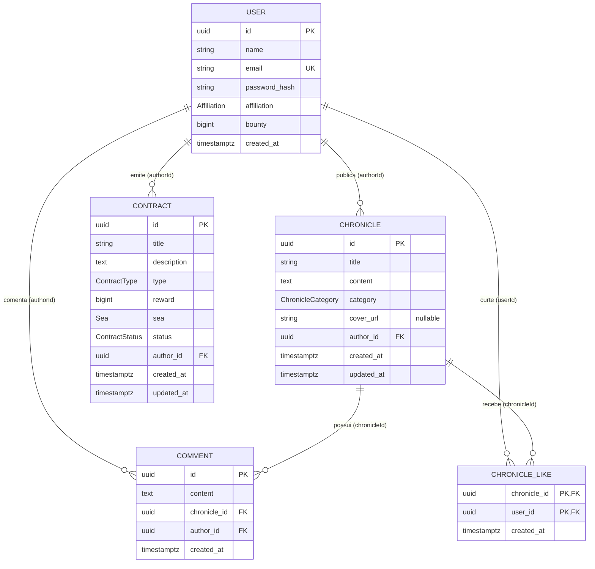
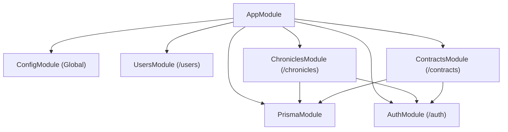
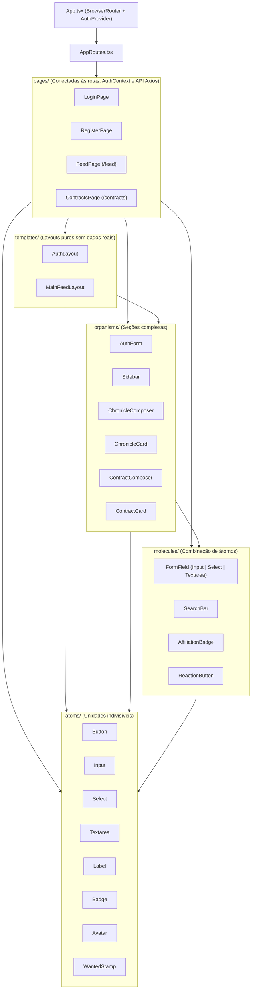

# Plano de Implementação — Feed de Crônicas, Mural de Contratos & Integração Full-Stack

## 1. Contexto e Diagnóstico Atual

Após inspeção completa do monorepo, este é o ponto de partida atual:

- **Back-end (`apps/api`):**
  - NestJS 12 + TypeScript 6 + Prisma 7 (`@prisma/client` + `@prisma/adapter-pg` + `pg`) + PostgreSQL 16 via Docker (`docker-compose.yml`).
  - `UsersModule` (`POST /users`) e `AuthModule` (`POST /auth/login`, `GET /auth/me`, `JwtAuthGuard`, `@CurrentUser()`) já implementados, documentados no Swagger (`/api/docs`) e cobertos por testes unitários Jest + `oxlint --type-aware`.
  - `schema.prisma` contém atualmente o enum `Affiliation` e o modelo `User` (com `bounty BigInt` serializado como `number` e `USER_PUBLIC_SELECT` impedindo vazamento de `passwordHash`).
- **Front-end (`apps/web`):**
  - React 19 + Vite 8 + Tailwind CSS v4 (`@theme` configurado em `src/index.css` com os 7 tokens semânticos calibrados para WCAG 2 AA) + `react-router-dom` v7 + Vitest + Testing Library + `jest-axe`.
  - Componentes já existentes:
    - `atoms/`: `Badge`, `Button`, `Input`, `Label`, `Select`
    - `molecules/`: `FormField`
    - `organisms/`: `AuthForm`
    - `templates/`: `AuthLayout`
    - `pages/`: `LoginPage` e `RegisterPage` (com pontos de integração preparados para a API real).
- **Objetivo desta etapa:** Construir o núcleo completo do **Grand Line Hub** ponta a ponta — modelagem Prisma + migration + Full-Text Search em PostgreSQL + seed temático de One Piece, módulos REST `ChroniclesModule` e `ContractsModule` com Swagger e Jest, e integração completa no front-end (`axios`, `AuthContext`, `MainFeedLayout`, `FeedPage`, `ContractsPage` e toda a árvore Atomic Design com testes `jest-axe`).

---

## 2. Banco de Dados, Full-Text Search & Seed (`apps/api`)

### 2.1. Diagrama Entidade-Relacionamento



### 2.2. Evolução do `apps/api/prisma/schema.prisma`

Mantendo as convenções já estabelecidas (`snake_case` nas colunas/tabelas PostgreSQL, `@db.Uuid`, `@db.Timestamptz` em UTC e deleção em cascata nas chaves estrangeiras):

```prisma
enum Affiliation {
  PIRATE
  MARINE
  REVOLUTIONARY
  BOUNTY_HUNTER
}

enum ChronicleCategory {
  VOYAGE_LOG
  ISLAND_DISCOVERY
  AKUMA_NO_MI
  VOID_CENTURY
}

enum ContractType {
  CREW_RECRUITMENT
  BOUNTY_HUNTER
}

enum Sea {
  EAST_BLUE
  GRAND_LINE
  NEW_WORLD
}

enum ContractStatus {
  OPEN
  IN_PROGRESS
  COMPLETED
}

model User {
  id             String          @id @default(uuid()) @db.Uuid
  name           String
  email          String          @unique
  passwordHash   String          @map("password_hash")
  affiliation    Affiliation
  bounty         BigInt          @default(0)
  createdAt      DateTime        @default(now()) @map("created_at") @db.Timestamptz
  chronicles     Chronicle[]
  comments       Comment[]
  chronicleLikes ChronicleLike[]
  contracts      Contract[]

  @@map("users")
}

model Chronicle {
  id        String            @id @default(uuid()) @db.Uuid
  title     String
  content   String            @db.Text
  category  ChronicleCategory
  coverUrl  String?           @map("cover_url")
  authorId  String            @map("author_id") @db.Uuid
  createdAt DateTime          @default(now()) @map("created_at") @db.Timestamptz
  updatedAt DateTime          @updatedAt @map("updated_at") @db.Timestamptz

  author   User            @relation(fields: [authorId], references: [id], onDelete: Cascade)
  comments Comment[]
  likes    ChronicleLike[]

  @@index([createdAt(sort: Desc)])
  @@index([category, createdAt(sort: Desc)])
  @@index([authorId])
  @@map("chronicles")
}

model ChronicleLike {
  chronicleId String   @map("chronicle_id") @db.Uuid
  userId      String   @map("user_id") @db.Uuid
  createdAt   DateTime @default(now()) @map("created_at") @db.Timestamptz

  chronicle Chronicle @relation(fields: [chronicleId], references: [id], onDelete: Cascade)
  user      User      @relation(fields: [userId], references: [id], onDelete: Cascade)

  @@id([chronicleId, userId])
  @@index([userId])
  @@map("chronicle_likes")
}

model Comment {
  id          String   @id @default(uuid()) @db.Uuid
  content     String   @db.Text
  chronicleId String   @map("chronicle_id") @db.Uuid
  authorId    String   @map("author_id") @db.Uuid
  createdAt   DateTime @default(now()) @map("created_at") @db.Timestamptz

  chronicle Chronicle @relation(fields: [chronicleId], references: [id], onDelete: Cascade)
  author    User      @relation(fields: [authorId], references: [id], onDelete: Cascade)

  @@index([chronicleId, createdAt])
  @@index([authorId])
  @@map("comments")
}

model Contract {
  id          String         @id @default(uuid()) @db.Uuid
  title       String
  description String         @db.Text
  type        ContractType
  reward      BigInt         @default(0)
  sea         Sea
  status      ContractStatus @default(OPEN)
  authorId    String         @map("author_id") @db.Uuid
  createdAt   DateTime       @default(now()) @map("created_at") @db.Timestamptz
  updatedAt   DateTime       @updatedAt @map("updated_at") @db.Timestamptz

  author User @relation(fields: [authorId], references: [id], onDelete: Cascade)

  @@index([sea, type, status, createdAt(sort: Desc)])
  @@index([createdAt(sort: Desc)])
  @@index([authorId])
  @@map("contracts")
}
```

### 2.3. Estratégia de Full-Text Search Nativo no PostgreSQL 16

Para atender à busca `?search=termo` em `GET /chronicles` e `GET /contracts` com performance real de banco e segurança total contra SQL Injection:

1. **Índices GIN Funcionais na Migration SQL (`add_chronicles_and_contracts`):**
   - Criaremos a migration com `prisma migrate dev --create-only --name add_chronicles_and_contracts` e adicionaremos ao arquivo `migration.sql` os índices GIN ponderados usando a configuração nativa `'portuguese'` do PostgreSQL 16 (peso `'A'` para `title` e peso `'B'` para `content`/`description`), aplicando em seguida `prisma migrate dev`:
     ```sql
     CREATE INDEX "chronicles_fts_idx" ON "chronicles"
     USING GIN (
       (
         setweight(to_tsvector('portuguese', coalesce("title", '')), 'A') ||
         setweight(to_tsvector('portuguese', coalesce("content", '')), 'B')
       )
     );

     CREATE INDEX "contracts_fts_idx" ON "contracts"
     USING GIN (
       (
         setweight(to_tsvector('portuguese', coalesce("title", '')), 'A') ||
         setweight(to_tsvector('portuguese', coalesce("description", '')), 'B')
       )
     );
     ```
2. **Execução em 2 Fases nos Services (`$queryRaw` parametrizado + Hidratação Segura):**
   - **Sem `?search`:** `prisma.chronicle.findMany` / `prisma.contract.findMany` + `count` em paralelo (`Promise.all`), ordenando por `createdAt: 'desc'`.
   - **Com `?search=termo`:**
     1. Query parametrizada com `Prisma.sql` usando `websearch_to_tsquery('portuguese', ${term})` (que aceita frases entre aspas, operadores e caracteres especiais sem nunca quebrar a sintaxe de `tsquery`) combinada a `ILIKE` de apoio para prefixos/nomes próprios curtos de One Piece (ex.: `"Poneg"`, `"Skyp"`), ordenando por `ts_rank(...) DESC, created_at DESC` e aplicando os demais filtros (`category`, `sea`, `type`, `status`), `LIMIT` e `OFFSET`.
     2. Hidratação dos registros da página por `id IN (...)` via `findMany` usando `AUTHOR_PUBLIC_SELECT` (garantindo em tempo de compilação que `passwordHash` jamais seja lido ou retornado) e preservando a ordem exata de `ts_rank`.

### 2.4. Seed Temático Idempotente (`apps/api/prisma/seed.ts`)

1. **Configuração Prisma 7:**
   - Atualizar `apps/api/prisma.config.ts` adicionando `seed: 'node ./node_modules/ts-node/dist/bin.js prisma/seed.ts'` (ou script compatível com Node 24 + CommonJS) em `migrations`.
   - Adicionar `"prisma:seed": "prisma db seed"` em `apps/api/package.json` e `"db:seed": "pnpm --filter api prisma:seed"` no `package.json` raiz.
2. **Dados Ricos do Universo One Piece (idempotentes via `upsert` / limpeza controlada em transação):**
   - **6 Usuários (cobrindo todas as 4 afiliações e recompensas `BigInt` acima de 32 bits, senha padrão de demonstração `GrandLine@2026` com hash `bcrypt`):**
     - `nico.robin@ohara.gl` — **Nico Robin** (`PIRATE`, `bounty: 930_000_000n`)
     - `luffy@thousand-sunny.gl` — **Monkey D. Luffy** (`PIRATE`, `bounty: 3_000_000_000n`)
     - `zoro@thousand-sunny.gl` — **Roronoa Zoro** (`BOUNTY_HUNTER`, `bounty: 1_111_000_000n`)
     - `smoker@g5-marine.gl` — **Vice-Almirante Smoker** (`MARINE`, `bounty: 0n`)
     - `sabo@baltigo.gl` — **Sabo** (`REVOLUTIONARY`, `bounty: 602_000_000n`)
     - `law@polar-tang.gl` — **Trafalgar D. Water Law** (`PIRATE`, `bounty: 3_000_000_000n`)
   - **6 Crônicas (`Chronicle`) variando categorias e presença/ausência de `coverUrl`:**
     1. *Inscrições em Poneglyphs Submersos Perto de Water 7* (`VOID_CENTURY`, autora Nico Robin, **sem `coverUrl`** — exercita o placeholder visual temático).
     2. *Anomalias Magnéticas entre Jaya e a Corrente Knock Up* (`ISLAND_DISCOVERY`, autor Luffy, **com `coverUrl`: `http://localhost:5173/banner-login.jpg`**).
     3. *Propriedades Espaciais do Despertar da Ope Ope no Mi* (`AKUMA_NO_MI`, autor Trafalgar Law, **sem `coverUrl`**).
     4. *Relatório Tático G-5: Tempestades de Raios em Raijin Island* (`VOYAGE_LOG`, autor Smoker, **sem `coverUrl`**).
     5. *Rotas Clandestinas de Suprimentos ao Redor de Mary Geoise* (`VOYAGE_LOG`, autor Sabo, **com `coverUrl`: `http://localhost:5173/banner-register.jpg`**).
     6. *Os Tambores da Libertação e o Registro Apagado de Joy Boy* (`VOID_CENTURY`, autora Nico Robin, **sem `coverUrl`**).
   - **Comentários e Curtidas iniciais:** Diálogos temáticos entre os personagens distribuídos nas crônicas para popular contadores e threads.
   - **6 Contratos (`Contract`) cobrindo todos os mares (`EAST_BLUE`, `GRAND_LINE`, `NEW_WORLD`), tipos e status:**
     1. *Procura-se Músico Corajoso para Navegar pelo Florian Triangle* (`CREW_RECRUITMENT`, `GRAND_LINE`, `OPEN`, `reward: 0n`, autor Luffy).
     2. *Captura da Frota Pirata Krieg nos Arredores do Baratie* (`BOUNTY_HUNTER`, `EAST_BLUE`, `COMPLETED`, `reward: 17_000_000n`, autor Smoker).
     3. *Neutralização de Contrabandistas de Armas no Porto Subterrâneo de Dressrosa* (`BOUNTY_HUNTER`, `NEW_WORLD`, `IN_PROGRESS`, `reward: 450_000_000n`, autor Sabo).
     4. *Especialista em Log Pose Triplo para Expedição no Novo Mundo* (`CREW_RECRUITMENT`, `NEW_WORLD`, `OPEN`, `reward: 120_000_000n`, autor Law).
     5. *Caçada ao Bando dos Piratas Buggy em Orange Town* (`BOUNTY_HUNTER`, `EAST_BLUE`, `OPEN`, `reward: 15_000_000n`, autor Zoro).
     6. *Carpinteiro Naval com Domínio de Madeira Adam para Reparos de Emergência* (`CREW_RECRUITMENT`, `GRAND_LINE`, `IN_PROGRESS`, `reward: 85_000_000n`, autor Sabo).

---

## 3. Endpoints REST, Segurança, Swagger & Testes (`apps/api`)

### 3.1. Arquitetura de Módulos no NestJS



### 3.2. Guard Opcional para Leitura Pública Hidratada (`OptionalJwtAuthGuard`)

- Em `GET /chronicles`, visitantes não autenticados devem receber `200 OK` normalmente (`likedByMe: false`), enquanto usuários autenticados que enviam `Authorization: Bearer <token>` devem receber `likedByMe: true | false` refletindo suas curtidas reais.
- Criaremos `src/auth/guards/optional-jwt-auth.guard.ts` (exportado pelo `AuthModule`):
  - Se não houver header `Bearer` ou se o token estiver expirado/inválido em rota pública, segue sem lançar erro (`request.user = undefined`).
  - Se o token for válido e o usuário existir, popula `request.user` via `UsersService.findById`.
- Criaremos também o decorator `@OptionalCurrentUser()` retornando `UserResponseDto | undefined`.

### 3.3. Especificação das Rotas REST e Status Codes

| Método & Rota | Acesso | Query / Body DTO | Status Codes | Comportamento |
| :--- | :--- | :--- | :--- | :--- |
| `GET /chronicles` | Público (`OptionalJwtAuthGuard`) | `QueryChroniclesDto` (`?page=1&limit=10&search=&category=`) | `200`, `400` | Lista crônicas paginadas com FTS PostgreSQL, dados públicos do autor, `likesCount`, `commentsCount`, `likedByMe` e lista de comentários ordenados. |
| `POST /chronicles` | `JwtAuthGuard` | `CreateChronicleDto` (`title`, `content`, `category`, `coverUrl?`) | `201`, `400`, `401` | Cria nova crônica vinculada ao `@CurrentUser()`. |
| `POST /chronicles/:id/likes` | `JwtAuthGuard` | `@Param('id', ParseUUIDPipe)` | `200`, `400`, `401`, `404` | Registra curtida de forma idempotente (`upsert` na PK composta) e retorna `{ chronicleId, liked: true, likesCount }`. |
| `DELETE /chronicles/:id/likes` | `JwtAuthGuard` | `@Param('id', ParseUUIDPipe)` | `200`, `400`, `401`, `404` | Remove curtida (`deleteMany`) e retorna `{ chronicleId, liked: false, likesCount }`. |
| `GET /chronicles/:id/comments` | Público | `@Param('id', ParseUUIDPipe)` | `200`, `400`, `404` | Lista comentários de uma crônica em ordem cronológica (sem `passwordHash`). |
| `POST /chronicles/:id/comments` | `JwtAuthGuard` | `CreateCommentDto` (`content`) | `201`, `400`, `401`, `404` | Adiciona comentário na crônica existente e retorna `CommentResponseDto`. |
| `GET /contracts` | Público | `QueryContractsDto` (`?page=1&limit=10&search=&sea=&type=&status=`) | `200`, `400` | Lista contratos paginados com FTS PostgreSQL e filtros combinados por mar, tipo e status (`reward` serializado como `number`). |
| `POST /contracts` | `JwtAuthGuard` | `CreateContractDto` (`title`, `description`, `type`, `reward`, `sea`) | `201`, `400`, `401` | Cria contrato com `status: OPEN` e `reward` persistido como `BigInt`. |
| `PATCH /contracts/:id/status` | `JwtAuthGuard` | `UpdateContractStatusDto` (`status`) | `200`, `400`, `401`, `403`, `404` | Verifica existência (`404`) e autoria (`contract.authorId === user.id`, lançando `403 Forbidden` caso contrário), atualizando o status. |

### 3.4. Estrutura de Arquivos a Criar/Atualizar em `apps/api`

```text
apps/api/
├── prisma.config.ts                                    # Adiciona comando de seed em migrations.seed
├── prisma/
│   ├── schema.prisma                                   # Novos enums e models Chronicle, ChronicleLike, Comment, Contract
│   ├── seed.ts                                         # Seed temático rico e idempotente de One Piece
│   └── migrations/
│       └── <timestamp>_add_chronicles_and_contracts/
│           └── migration.sql                           # Tabelas, FKs, índices B-tree e índices GIN de FTS
└── src/
    ├── app.module.ts                                   # Registra ChroniclesModule e ContractsModule
    ├── common/
    │   └── dto/
    │       ├── pagination-query.dto.ts                 # page (default 1), limit (default 10, max 50), search opcional
    │       ├── pagination-meta.dto.ts                  # page, limit, total, totalPages, hasNextPage, hasPreviousPage
    │       └── author-summary.dto.ts                   # id, name, affiliation, bounty + AUTHOR_PUBLIC_SELECT
    ├── auth/
    │   ├── auth.module.ts                              # Exporta OptionalJwtAuthGuard
    │   ├── decorators/
    │   │   └── optional-current-user.decorator.ts
    │   └── guards/
    │       ├── optional-jwt-auth.guard.ts
    │       └── optional-jwt-auth.guard.spec.ts
    ├── chronicles/
    │   ├── chronicles.module.ts
    │   ├── chronicles.controller.ts
    │   ├── chronicles.service.ts
    │   ├── chronicles.service.spec.ts
    │   ├── enums/
    │   │   └── chronicle-category.enum.ts
    │   └── dto/
    │       ├── create-chronicle.dto.ts
    │       ├── create-comment.dto.ts
    │       ├── query-chronicles.dto.ts
    │       ├── comment-response.dto.ts
    │       ├── chronicle-like-response.dto.ts
    │       └── chronicle-response.dto.ts               # Inclui PaginatedChroniclesResponseDto
    └── contracts/
        ├── contracts.module.ts
        ├── contracts.controller.ts
        ├── contracts.service.ts
        ├── contracts.service.spec.ts
        ├── enums/
        │   ├── contract-type.enum.ts
        │   ├── sea.enum.ts
        │   └── contract-status.enum.ts
        └── dto/
            ├── create-contract.dto.ts
            ├── update-contract-status.dto.ts
            ├── query-contracts.dto.ts
            └── contract-response.dto.ts                # Inclui PaginatedContractsResponseDto
```

### 3.5. Testes Unitários Jest (`apps/api`)

1. **`optional-jwt-auth.guard.spec.ts`:**
   - Permite acesso anônimo (`true`, `request.user === undefined`) quando não há header `Authorization` ou quando o token está inválido/expirado.
   - Injeta `request.user` sanitizado quando o Bearer token é válido.
2. **`chronicles.service.spec.ts`:**
   - Listagem paginada padrão (`page`, `limit`, cálculo de `totalPages`, `likedByMe` verdadeiro para usuário logado e falso para visitante, ausência de `passwordHash`).
   - Busca Full-Text (`?search=poneglyph`) acionando `$queryRaw` parametrizado e preservando a ordem de relevância retornada pelo PostgreSQL.
   - Criação de crônica com e sem `coverUrl`.
   - Curtir (`POST /chronicles/:id/likes`) e descurtir (`DELETE /chronicles/:id/likes`) com verificação de `NotFoundException` (`404`) para crônica inexistente.
   - Criação de comentário (`POST /chronicles/:id/comments`) e `NotFoundException` (`404`) quando a crônica não existe.
3. **`contracts.service.spec.ts`:**
   - Listagem paginada com filtros combinados (`sea`, `type`, `status`) e conversão `BigInt -> number` em `reward` (incluindo valores acima de `2^31 - 1`).
   - Busca Full-Text (`?search=espada`) via `$queryRaw` parametrizado.
   - Criação de contrato iniciando em `OPEN` com `BigInt(dto.reward)`.
   - `updateStatus` retornando `200` quando chamado pelo próprio autor, `ForbiddenException` (`403`) quando chamado por outro usuário autenticado, e `NotFoundException` (`404`) quando o contrato não existe.

---

## 4. Integração HTTP, `AuthContext` & Telas no Front-end (`apps/web`)

### 4.1. Hierarquia Estrita de Atomic Design

Nenhum nível importará de um nível superior (`atoms` -> `molecules` -> `organisms` -> `templates` -> `pages`):



### 4.2. Camada de Serviços HTTP (`axios`) e `AuthContext`

1. **Dependência:** Instalar `axios` em `apps/web` (`pnpm --filter web add axios`).
2. **Cliente Axios (`src/services/api.ts`):**
   - `baseURL: import.meta.env.VITE_API_URL ?? 'http://localhost:3000'`.
   - Interceptor de requisição lendo o token de `localStorage` (`grand_line_hub_token`) e anexando `Authorization: Bearer <token>`.
   - Utilitário `getApiErrorMessage(error, fallback)` extraindo mensagens legíveis em português das respostas do NestJS (`string` ou `string[]`).
3. **Serviços Tipados (`src/services/`):**
   - `auth.service.ts`: `loginUser()`, `registerUser()`, `fetchCurrentUser()`.
   - `chronicles.service.ts`: `listChronicles({ page, limit, search, category })`, `createChronicle()`, `likeChronicle()`, `unlikeChronicle()`, `createComment()`.
   - `contracts.service.ts`: `listContracts({ page, limit, search, sea, type, status })`, `createContract()`, `updateContractStatus()`.
4. **`AuthContext` (`src/contexts/AuthContext.tsx`):**
   - Expõe `{ user, isAuthenticated, isInitializing, login, register, logout }`.
   - Na montagem inicial, se existir token salvo, consulta `GET /auth/me` para restaurar a sessão; se retornar `401`, limpa o token silenciosamente para não bloquear a navegação como visitante.
   - `register()` executa `POST /users`, autentica automaticamente via `POST /auth/login` + `GET /auth/me` e leva o usuário direto para `/feed`.
5. **Rotas (`src/routes/AppRoutes.tsx`):**
   - `/` -> `<Navigate to="/feed" replace />` (visitantes já caem direto na experiência principal de leitura).
   - `/feed` -> `<FeedPage />` (pública com recursos interativos habilitados para autenticados).
   - `/contracts` -> `<ContractsPage />` (pública com criação/gestão habilitada para autenticados).
   - `/login` -> `<LoginPage />` (conectada ao `useAuth().login`, redirecionando para `/feed` ao autenticar e oferecendo link *"Explorar como visitante"*).
   - `/register` -> `<RegisterPage />` (conectada ao `useAuth().register`, redirecionando para `/feed` após alistamento).
   - `*` -> `<Navigate to="/feed" replace />`.

### 4.3. Especificação dos Novos Componentes UI & Tokens Tailwind v4

Todos os componentes usarão **exclusivamente** os tokens semânticos definidos no `@theme` (`ocean-abyss`, `ship-deck`, `parchment`, `mist-gray`, `treasure-gold`, `log-pose-cyan`, `crimson-bounty`) e classes utilitárias padrão do Tailwind — **zero valores hexadecimais hardcoded e zero medidas arbitrárias em pixels**:

1. **Átomos (`src/components/atoms/`):**
   - `Textarea`: `<textarea>` acessível com suporte a `hasError`, `aria-invalid`, foco `ring-log-pose-cyan` e superfície `bg-ship-deck` (integrado também à molécula `FormField` via `multiline`).
   - `Avatar`: Emblema circular com iniciais extraídas do nome/alcunha (`bg-ship-deck border border-treasure-gold/40 text-treasure-gold font-display font-bold`), tamanhos `'sm' | 'md' | 'lg'`.
   - `WantedStamp`: Carimbo temático em `font-mono` exibindo recompensas formatadas em Berries (`฿ 3.000.000.000` via `Intl.NumberFormat('pt-BR')`) ou inscrição `"DIVISÃO DE ESPÓLIOS"` quando `reward === 0` em recrutamento de tripulação, com variantes `'bounty'` (`treasure-gold`), `'wanted'` (`crimson-bounty`) e `'crew'` (`log-pose-cyan`).
2. **Moléculas (`src/components/molecules/`):**
   - `SearchBar`: Formulário semântico `<form role="search">` com `Label` (`sr-only`), `Input`, botão de limpar busca e `Button` de submissão, suportando busca por envio e atualização controlada.
   - `AffiliationBadge`: Mapeia `Affiliation` para `Badge` semântico em português (`PIRATE` -> *Pirata* `danger`, `MARINE` -> *Marinha* `info`, `REVOLUTIONARY` -> *Revolucionário* `gold`, `BOUNTY_HUNTER` -> *Caçador de Recompensas* `neutral`).
   - `ReactionButton`: Botão acessível de curtida (`aria-pressed={liked}`, contador em `font-mono`). Quando `disabledForVisitor` é `true`, exibe estado bloqueado acessível (`disabled` + dica clara para visitantes).
3. **Organismos (`src/components/organisms/`):**
   - `Sidebar`:
     - Cabeçalho com `/logo-grand-line.jpg` + título **Grand Line Hub**.
     - `<nav aria-label="Navegação principal">` com links para **Crônicas da Grand Line** (`/feed`) e **Mural de Contratos** (`/contracts`), destacando a rota ativa com `bg-log-pose-cyan/15 text-log-pose-cyan border-log-pose-cyan/40`.
     - Painel inferior condicional:
       - **Autenticado:** `Avatar`, nome, `AffiliationBadge`, recompensa atual com `WantedStamp` e botão **Sair** (`variant="outline"`).
       - **Visitante:** Resumo convidando ao alistamento + botões **Entrar** (`/login`) e **Criar Conta** (`/register`).
   - `ChronicleCard`:
     - Cabeçalho com `Badge` da categoria traduzida (*Relato de Navegação*, *Descoberta de Ilha*, *Akuma no Mi*, *Século Perdido*), data formatada e dados do autor (`Avatar` + nome + `AffiliationBadge`).
     - **Arte de Capa ou Placeholder Visual Náutico:**
       - Se `coverUrl` existir (e carregar com sucesso): renderiza ``.
       - **Se `coverUrl` for `null`/ausente (ou falhar no `onError`):** renderiza um banner placeholder temático construído com tokens do tema (`bg-ocean-abyss`, rosa-dos-ventos / Log Pose vetorial em SVG `aria-hidden="true"`, filetes em `border-treasure-gold/25` e legenda náutica *"Registro Cartográfico sem Ilustração Anexada"* em `text-mist-gray`).
     - Título `<h2>`, conteúdo formatado, barra de ações com `ReactionButton` e seção expansível de comentários:
       - **Autenticado:** campo acessível para publicar comentário (`POST /chronicles/:id/comments`).
       - **Visitante:** bloqueia curtidas e envio de comentários, exibindo aviso semântico com link para `/login` (*"Entre no convés para curtir ou comentar nesta crônica"*).
   - `ChronicleComposer`:
     - Quando autenticado, permite abrir/preencher o formulário de nova crônica (`title`, `category`, `coverUrl` opcional, `content`) com validação acessível. Quando visitante, exibe card compacto convidando a entrar na conta para publicar crônicas.
   - `ContractCard`:
     - Estética de edital marítimo / cartaz de procurado em `bg-ship-deck`, diferenciando `BOUNTY_HUNTER` (`danger` / `crimson-bounty`) e `CREW_RECRUITMENT` (`info` / `log-pose-cyan`), badge do mar (`East Blue`, `Grand Line`, `Novo Mundo`), badge de status (`Aberto`, `Em Andamento`, `Concluído`) e `WantedStamp` com a recompensa em Berries.
     - **Controle exclusivo do autor:** quando `currentUserId === contract.author.id`, exibe seletor/ações acessíveis para atualizar o status (`OPEN` | `IN_PROGRESS` | `COMPLETED`) via `PATCH /contracts/:id/status`.
   - `ContractComposer`:
     - Formulário validado para publicar novo contrato (`title`, `type`, `sea`, `reward`, `description`) quando autenticado, ou convite de login para visitantes.
4. **Template (`src/components/templates/MainFeedLayout/`):**
   - Template puro (sem acesso direto a `AuthContext` ou `axios`), estruturado com `flex min-h-svh flex-col lg:flex-row bg-ocean-abyss text-parchment`.
   - Em telas menores (`< lg`), exibe barra superior compacta com botão acessível (`aria-expanded`, `aria-controls`) que abre/fecha a `Sidebar` responsiva; em `lg+`, mantém a `Sidebar` fixa na lateral (`lg:w-72 lg:shrink-0`).
   - Área `<main>` com cabeçalho semântico (`Badge`, `<h1>`, subtítulo, slot opcional de ações) e container `{children}`.
5. **Páginas (`src/components/pages/`):**
   - `FeedPage`: Integra busca full-text (`SearchBar`), filtro rápido por categoria, `ChronicleComposer`, listagem de `ChronicleCard`, paginação (`Anterior` / `Próxima`), curtidas otimistas/sincronizadas e criação de comentários.
   - `ContractsPage`: Integra busca full-text (`SearchBar`), filtros combinados por **Mar** (`EAST_BLUE`, `GRAND_LINE`, `NEW_WORLD`), **Tipo** (`CREW_RECRUITMENT`, `BOUNTY_HUNTER`) e **Status** (`OPEN`, `IN_PROGRESS`, `COMPLETED`), `ContractComposer`, grade de `ContractCard` e atualização de status pelo autor.

### 4.4. Estrutura de Arquivos Planejada em `apps/web/src/`

```text
apps/web/src/
├── contexts/
│   ├── AuthContext.tsx
│   └── AuthContext.test.tsx
├── services/
│   ├── api.ts
│   ├── auth.service.ts
│   ├── chronicles.service.ts
│   └── contracts.service.ts
├── types/
│   └── domain.ts                                       # Tipos espelhados da API (User, Chronicle, Comment, Contract, Paginated)
├── utils/
│   └── formatters.ts                                   # formatBerries(), formatRelativeOrShortDate(), labels de enums
├── components/
│   ├── atoms/
│   │   ├── Avatar/ (Avatar.tsx, Avatar.test.tsx, index.ts)
│   │   ├── Textarea/ (Textarea.tsx, Textarea.test.tsx, index.ts)
│   │   └── WantedStamp/ (WantedStamp.tsx, WantedStamp.test.tsx, index.ts)
│   ├── molecules/
│   │   ├── FormField/ (atualizado para suportar Textarea + testes)
│   │   ├── SearchBar/ (SearchBar.tsx, SearchBar.test.tsx, index.ts)
│   │   ├── AffiliationBadge/ (AffiliationBadge.tsx, AffiliationBadge.test.tsx, index.ts)
│   │   └── ReactionButton/ (ReactionButton.tsx, ReactionButton.test.tsx, index.ts)
│   ├── organisms/
│   │   ├── Sidebar/ (Sidebar.tsx, Sidebar.test.tsx, index.ts)
│   │   ├── ChronicleCard/ (ChronicleCard.tsx, ChronicleCard.test.tsx, index.ts)
│   │   ├── ChronicleComposer/ (ChronicleComposer.tsx, ChronicleComposer.test.tsx, index.ts)
│   │   ├── ContractCard/ (ContractCard.tsx, ContractCard.test.tsx, index.ts)
│   │   └── ContractComposer/ (ContractComposer.tsx, ContractComposer.test.tsx, index.ts)
│   ├── templates/
│   │   └── MainFeedLayout/ (MainFeedLayout.tsx, MainFeedLayout.test.tsx, index.ts)
│   └── pages/
│       ├── LoginPage/ (integrada ao AuthContext + testes atualizados)
│       ├── RegisterPage/ (integrada ao AuthContext + testes atualizados)
│       ├── FeedPage/ (FeedPage.tsx, FeedPage.test.tsx, index.ts)
│       └── ContractsPage/ (ContractsPage.tsx, ContractsPage.test.tsx, index.ts)
├── routes/
│   └── AppRoutes.tsx
└── App.tsx
```

### 4.5. Matriz de Testes e Acessibilidade (`Vitest` + `jest-axe`)

Todo componente criado ou alterado terá seu `.test.tsx` colocalizado validando renderização, interações e **`expect(await axe(container)).toHaveNoViolations()`**:

| Alvo | Cenários Validados |
| :--- | :--- |
| `Textarea`, `Avatar`, `WantedStamp` | Atributos semânticos, formatação em Berries (`BigInt`/grandes números), estados de erro e `axe`. |
| `SearchBar`, `AffiliationBadge`, `ReactionButton` | Submissão e limpeza de busca, mapeamento das 4 afiliações, `aria-pressed`, bloqueio para visitantes e `axe`. |
| `Sidebar` | Exibição de perfil + recompensa + botão *Sair* quando autenticado; botão *Entrar* quando visitante; link ativo e `axe`. |
| `ChronicleCard` & `ChronicleComposer` | Renderização com `coverUrl` e com **placeholder visual** quando `coverUrl === null`, bloqueio de curtida/comentário para visitantes, envio de comentário/crônica quando autenticado e `axe`. |
| `ContractCard` & `ContractComposer` | Exibição de mar/tipo/status/recompensa, seletor de atualização de status visível apenas para o autor do contrato e `axe`. |
| `MainFeedLayout` | Estrutura de landmarks (`nav`, `main`), abertura/fechamento do menu mobile responsivo e `axe`. |
| `FeedPage` & `ContractsPage` | Integração com serviços mockados (busca `?search=`, filtros por mar/tipo, criação de crônica/contrato, curtida/comentário, estado de visitante vs logado) e `axe`. |
| `LoginPage`, `RegisterPage`, `AuthContext`, `AppRoutes` | Fluxo real de login/cadastro/hidratação `/auth/me`/logout, redirecionamento `/` -> `/feed` e `axe`. |

---

## 5. Ordem de Execução e Validação Final

Após aprovação deste plano, executaremos na seguinte sequência:

1. **Etapa 1 — Banco & Seed (`apps/api`):** Atualizar `schema.prisma`, gerar e aplicar migration com índices GIN de Full-Text Search no PostgreSQL 16, configurar e executar `prisma/seed.ts`.
2. **Etapa 2 — Módulos REST & Testes (`apps/api`):** Implementar `OptionalJwtAuthGuard`, `ChroniclesModule` e `ContractsModule` com DTOs `class-validator` + `@nestjs/swagger` e suíte unitária Jest (`pnpm api:test`, `pnpm api:build`, `pnpm --filter api lint`).
3. **Etapa 3 — Cliente HTTP, `AuthContext` & Componentes Base (`apps/web`):** Instalar `axios`, criar serviços tipados, `AuthContext`, novos `atoms` e `molecules` com testes `jest-axe`.
4. **Etapa 4 — Organismos, `MainFeedLayout` & Páginas (`apps/web`):** Implementar `Sidebar`, `ChronicleCard`, `ChronicleComposer`, `ContractCard`, `ContractComposer`, `MainFeedLayout`, `FeedPage`, `ContractsPage` e conectar `LoginPage`/`RegisterPage`/`AppRoutes`.
5. **Etapa 5 — Auditoria Completa de Qualidade:**
   - `pnpm api:test` & `pnpm web:test` (100% passando com zero violações `jest-axe`).
   - `pnpm lint`, `pnpm api:build` & `pnpm web:build` (zero erros de lint ou TypeScript).
   - Verificação por expressão regular em `apps/web/src/components/` garantindo **zero cores hexadecimais hardcoded** e **zero tamanhos arbitrários em pixels**.
   - Smoke test HTTP ponta a ponta validando Swagger (`/api/docs`), Full-Text Search, paginação e rotas protegidas (`200`, `201`, `400`, `401`, `403`, `404`).

---

## 6. Definições Aprovadas pelo Usuário

1. **Categorias de Crônicas (`Chronicle.category`):** Enum tipado `ChronicleCategory` (`VOYAGE_LOG`, `ISLAND_DISCOVERY`, `AKUMA_NO_MI`, `VOID_CENTURY`) com validação no banco/Swagger e filtro por categoria no Feed.
2. **Endpoints de Curtir/Descurtir Crônica:** Par REST idempotente com substantivo no plural `POST /chronicles/:id/likes` (curtir) e `DELETE /chronicles/:id/likes` (descurtir).
3. **Rota Inicial (`/`) e Fluxo Pós-Cadastro:** Redirecionar `/` para `/feed` (permitindo navegação imediata como visitante) e autenticar automaticamente após o cadastro enviando direto ao `/feed`.
